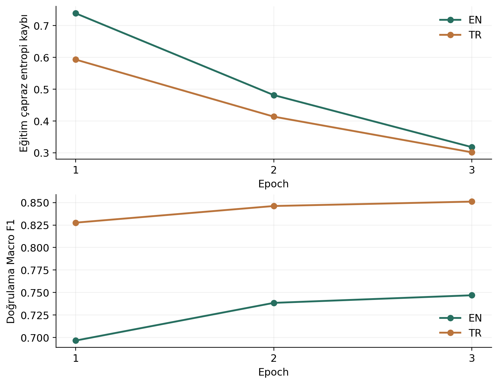
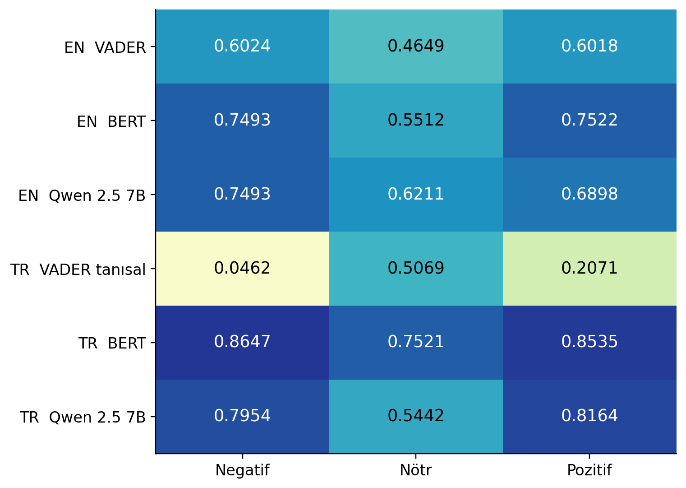
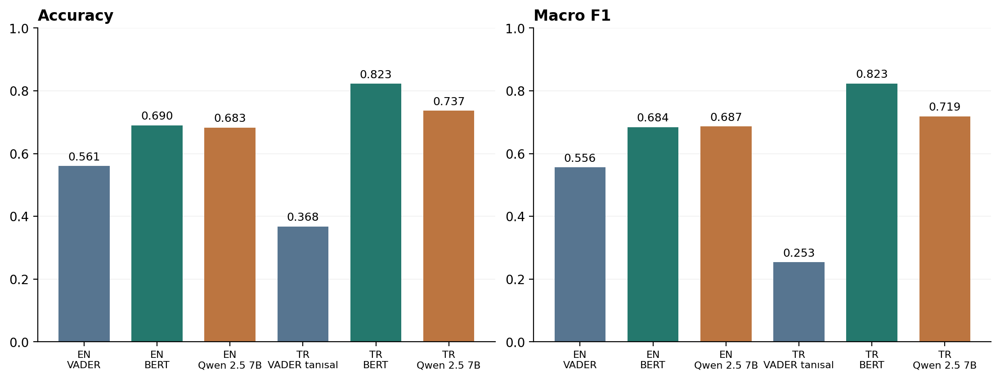
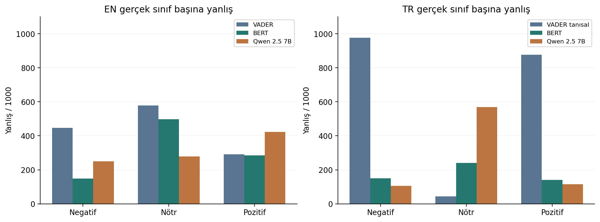
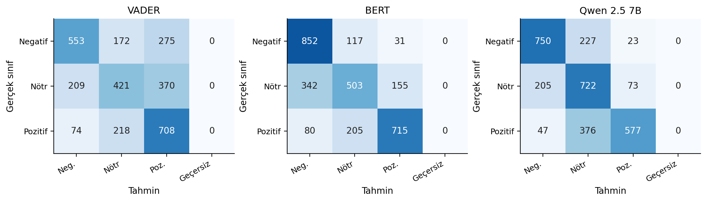
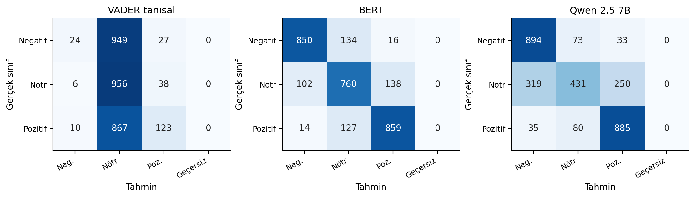
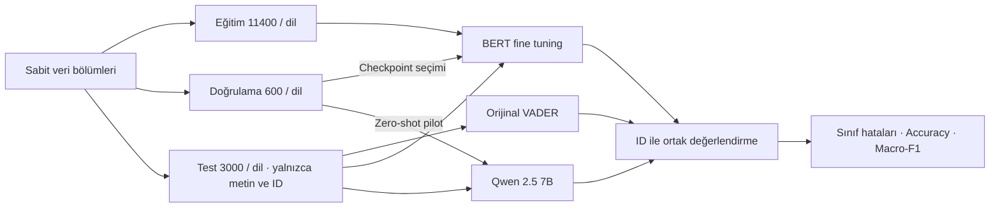

# İngilizce ve Türkçe metinlerde duygu analizi

**VADER · BERT · Qwen 2.5 7B**

İngilizce ve Türkçe metinlerde kural tabanlı, denetimli ve büyük dil modeli temelli duygu analizini karşılaştıran üniversite projesi. Her dilde **negatif, nötr ve pozitif** sınıfları aynı test ID'leri üzerinde değerlendirildi. Sonuçlar gerçek koşumlardan üretilmiştir.

**30.000 metin · 6 temel deney · 18.000 test tahmini · 14 başarılı yazılım testi**

[Sonuçlar](#gerçek-deney-sonuçları) · [Sınıf hataları](#sınıflara-göre-hatalar) · [Hata örnekleri](#gerçek-yorumlarla-hata-incelemesi) · [Kurulum](#kurulum-ve-yeniden-üretme) · [Kaynaklar](#kaynaklar)

[Tez düzeninde akademik Word raporu](deliverables/Proje_Raporu_Tez.docx) · [Kısa rapor](deliverables/Proje_Raporu.docx) · [3 kişilik sunum taslağı](deliverables/SUNUM_VE_KONUSMA_TASLAGI.md) · [Ham sonuç tablosu](deliverables/comparison.csv)

## Tez düzeninde akademik rapor

Genişletilmiş rapor **8 bölüm, 33 kaynak, 9 sayısal tablo, 7 grafik ve 6 denklem** içerir. Türkçe özet, İngilizce abstract, güncel içindekiler, literatür incelemesi, araştırma soruları, veri ve yöntem ayrıntıları, sınıf bazlı sonuçlar, gerçek hata vakaları, geçerlilik tartışması ve deney kimliklerini içeren ekler birlikte sunulur. Ana anlatı ve özetler yaklaşık **6.300 sözcüktür**.

**Akademik yorum:** İngilizce BERT ve Qwen'in küçük farkı için istatistiksel üstünlük iddia edilmez. Türkçede BERT'in toplam 259 örneklik avantajı, nötr sınıftaki 329 örneklik kazanım ile diğer iki sınıftaki toplam 70 örneklik kaybın bileşimidir. Türkçe VADER tanısal koşum olarak açıklanır. Yeni rapor mevcut deneyleri genişleterek yorumlar; çalıştırılmayan deneyler açıkça belirtilir.



Her dilde model seçimi doğrulama Macro-F1 ile yapıldı; seçilen epoch 3. Grafik üç ölçüm noktasını gösterir, daha uzun eğitimin davranışına ilişkin kanıt sağlamaz. [Sayısal epoch kayıtları](deliverables/tez_tables/epoch_metrics.csv).



Sınıf F1 değerleri kesinlik ile duyarlılığın dengesini gösterir. Türkçe Qwen negatif ve pozitif sınıflarında daha yüksek duyarlılığa sahip olsa da nötr örneklerden gelen yanlış pozitifler bu sınıfların kesinliğini düşürür. [Bütün tez grafikleri](deliverables/tez_figures) · [Kaynakça kayıtları](thesis_references.py).

GitHub raporunda öğrenci numaraları gizlidir. Tam bilgileri içeren teslim sürümü çalışma bilgisayarındaki `teslim_ozel` klasöründe tutulur ve depoya eklenmez. Teslim ZIP'i GitHub'a yüklenmez.

Raporu korunan sonuçlardan yeniden üretmek için ayrı bir Python ortamında:

```powershell
python -m pip install -r requirements-report.txt
python 13_build_thesis_assets.py
python 14_write_thesis.py
```

Windows ve Microsoft Word varsa `tools/finalize_thesis_word.ps1` içindekiler alanlarını güncelleyip denetim PDF'i oluşturur. Alternatif olarak belgeyi Word'de açıp tüm alanları güncellemek için **Ctrl+A, F9** kullanılabilir. Bu komutlar eğitim veya yeni LLM çağrısı yapmaz.

## Gerçek deney sonuçları



Her satır **3.000 test yorumu**, her gerçek sınıf **1.000 yorum** içerir. Aynı dilde bütün yöntemlere aynı test metinleri verilmiştir. Geçersiz çıktı sayısı altı koşumda da **0**'dır.

| Dil | Yöntem | Negatif yanlış | Nötr yanlış | Pozitif yanlış | Accuracy | Macro-F1 |
|---|---|---:|---:|---:|---:|---:|
| EN | VADER | 447 | 579 | 292 | %56,07 | 0,5564 |
| EN | BERT | 148 | 497 | 285 | %69,00 | 0,6843 |
| EN | Qwen 2.5 7B | 250 | 278 | 423 | %68,30 | 0,6867 |
| TR | VADER tanısal ¹ | 976 | 44 | 877 | %36,77 | 0,2534 |
| TR | BERT | 150 | 240 | 141 | %82,30 | 0,8234 |
| TR | Qwen 2.5 7B | 106 | 569 | 115 | %73,67 | 0,7187 |


¹ Türkçe doğrudan VADER, **tanısal başlangıç deneyidir**. Standart İngilizce sözlüğün Türkçe üzerindeki davranışını gösterir; yerleşik Türkçe duygu desteği olarak sunulmaz.

**Grafik nasıl okunur?** Her iki ölçekte de yüksek değer daha iyidir. Accuracy tüm testte doğru tahmin oranını, Macro-F1 üç sınıfın F1 ortalamasını gösterir. Grafiklerde gösterilmeyen ya da çalıştırılmamış deneyler sıfır puanmış gibi eklenmemiştir.

**İngilizce bulgu:** BERT accuracy bakımından %69,00 ile önde; Qwen Macro-F1 bakımından 0,6867 ile çok az yüksek. İki yöntemin Macro-F1 farkı yaklaşık **0,0024**; istatistiksel anlamlılık testi yapılmadı. Tek bir metrik üzerinden kesin model üstünlüğü çıkarılmamalı.

**Türkçe bulgu:** BERT hem accuracy hem Macro-F1 bakımından en yüksek genel sonucu verdi. Qwen negatif ve pozitif sınıflarında daha az hata yaparken nötr sınıfta 569 hata yaptı. Dolayısıyla sınıf davranışlarını ayrıca incelemek gerekiyor.

## Sınıflara göre hatalar



Her sütunun paydası **1.000**'dir. Düşük sütun daha az hata anlamına gelir. Hatalar gerçek sınıfa göre sayılır:

```text
Yanlış(c) = Gerçek etiketi c olan toplam yorum − doğru tahmin edilen c yorumları
```

Örneğin gerçek etiketi negatif olan bir yorum nötr tahmin edildiyse hata negatif sınıfa yazılır. Geçersiz veya başarısız bir model yanıtı da yanlış tahmindir; paydadan çıkarılmaz.

- İngilizce BERT, VADER'a göre negatif sınıf yanlışını **447'den 148'e** düşürdü.
- İngilizce Qwen'in nötr sınıfında **278**, BERT'in aynı sınıfında **497** yanlış tahmini var.
- Türkçe Qwen'in negatif ve pozitif sınıf yanlışları **106 ve 115**; nötr sınıf yanlışı **569**.
- Türkçe doğrudan VADER **3.000 yorumun 2.772'sini nötr** tahmin etti. Nötr sınıftaki yüksek recall tek başına başarı göstergesi değildir.

Sınıf başına destek, doğru, yanlış, hata oranı, precision, recall ve F1 değerleri [class_metrics.csv](deliverables/class_metrics.csv) dosyasında yer alır.

## Karışıklık matrisleri

### İngilizce



### Türkçe



**Satırlar gerçek sınıfı, sütunlar tahmini gösterir.** Köşegen doğru tahminlerdir; diğer hücreler hata yönleridir. Geçersiz çıktılar ayrı sütunda tutulur. Her satırın toplamı 1.000'dir.

Türkçe Qwen'de **nötr → negatif 319**, **nötr → pozitif 250** yorum görülür. Bu dağılım, nötr sınıf hatalarının tek yönde toplanmadığını gösterir. Türkçe BERT'te aynı iki yön **102 ve 138**'dir. Bütün yönler [error_directions.csv](deliverables/error_directions.csv) içinde saklanır.

## Veri ve deney tasarımı

| Dil | Kaynak | Alan | Eğitim | Doğrulama | Test |
|---|---|---|---:|---:|---:|
| İngilizce | TweetEval sentiment[^tweeteval] | Sosyal medya | 11.400 | 600 | 3.000 |
| Türkçe | TRSAv1[^trsa] | Ürün yorumları | 11.400 | 600 | 3.000 |

Her dilde her sınıftan eğitimde **3.800**, doğrulamada **200**, testte **1.000** yorum vardır. Kaynak ve temiz havuzların her sınıfı en az 1.000 yorum koşulunu karşılar. İngilizce resmi bölüm sınırları korunmuştur; Türkçe bölümler seed 42 ile sabitlenmiştir.



Boş metin, tam tekrar, çelişkili etiket, bölüm kesişimi ve dosya hashleri denetlendi. Emoji, noktalama, olumsuzluk ve büyük harf korunur. BERT yalnızca eğitim verisiyle öğrenir; checkpoint doğrulama Macro-F1 ile seçilir. LLM pilotu da doğrulama verisindedir. Test etiketleri modele gönderilmez ve test sonuçlarıyla prompt seçilmez.

[Veri manifesti](data/manifest.json) kaynak commitlerini, sınıf sayılarını ve altı CSV'nin SHA256 değerlerini; [veri denetimi](audit/data_integrity.json) kontrol bulgularını içerir. Tahminler satır sırasıyla eşleştirilmez.

## Yöntemler ve kaynaklardan kısa alıntılar

### VADER

> “a lexicon and rule-based sentiment analysis tool”
>
> Kaynak: [VADER'ın özgün deposu](https://github.com/cjhutto/vaderSentiment).[^vader]

Bu kısa tanım sözlük ve kurallara dayanan yaklaşımı açıklar. Deneyde `vaderSentiment==3.3.2` ve standart compound eşikleri kullanıldı: ≤ −0,05 negatif; ≥ 0,05 pozitif; arası nötr. Türkçeye doğrudan uygulama tanısaldır. Ayrı çeviri + VADER çalıştırıcısı hazırdır; **çeviri deneyi yapılmadı**.

### BERT

> “mostly intended to be fine-tuned on a downstream task”
>
> Kaynak: [İngilizce BERT model kartı](https://huggingface.co/google-bert/bert-base-uncased).[^bert]

Ön eğitimli modelin hazır bir üç sınıflı duygu sınıflandırıcısı olduğu varsayılmadı. İngilizcede `google-bert/bert-base-uncased`, Türkçede `dbmdz/bert-base-turkish-cased` üzerine üç çıkışlı başlık eklenerek fine tuning yapıldı.[^berturk]

| Parametre | Uygulanan değer |
|---|---|
| Learning rate | `2e-5` |
| Batch size / gradient accumulation | `16 / 1` |
| En fazla token / epoch | `256 / 3` |
| Seed | `42` |
| Checkpoint seçimi | Doğrulama Macro-F1; iki dilde de epoch 3 |
| Doğrulama Macro-F1 | EN `0,7469` · TR `0,8511` |
| Donanım | NVIDIA GeForce RTX 3080 Ti · 12 GB |

### Büyük dil modeli

> “Multilingual support for over 29 languages”
>
> Kaynak: [Qwen2.5-7B-Instruct model kartı](https://huggingface.co/Qwen/Qwen2.5-7B-Instruct).[^qwen]

İki dilde aynı **Qwen2.5 7B Instruct Q4_K_M** ağırlıkları ve aynı [zero-shot prompt](prompts/zero_shot_v1.txt) kullanıldı. Her dilde doğrulamadan 30 yorumla pilot yapıldı; prompt değiştirilmeden tam teste geçildi. Temperature 0, seed 42 ve en fazla üç deneme uygulandı. Ham yanıtlar, gecikmeler, token kullanımı ve yeniden denemeler [EN](runs/en_llm_test/records.jsonl) ve [TR](runs/tr_llm_test/records.jsonl) günlüklerinde saklanır. Başarısız yanıt nötre çevrilmez.

## Gerçek yorumlarla hata incelemesi

Aşağıdaki alıntılar değerlendirme verisindeki **gerçek metinlerdir**. Gerçek etiket kaynak veri setinden gelir; model tahmini korunmuştur. Açıklamalar olası yorumlardır, kesin hata nedeni veya yeniden etiketleme kararı değildir.

### İroni ve bağlam

> @user @user ISN'T it amazing stealing elections is so acceptable when leftists do it; don't let conservative pursue FAIR results!

**EN · VADER** — Kaynak etiket **negatif**, tahmin **pozitif**.

Amazing ve acceptable sözcükleri yüzeyde olumlu görünürken seçimlere ilişkin ifade eleştirel bir okuma taşır. İroni yorumu bağlama bağlıdır; bu tek örnek kategori sıklığına kanıt sayılmaz.

### Olumsuzluk kapsamı

> Can't believe how excited #Celtics fans are about Horford. Newsflash: He's not the 2nd coming of Tim Duncan.

**EN · BERT** — Kaynak etiket **nötr**, tahmin **pozitif**.

Excited sözcüğü taraftarların duygusunu aktarırken not the 2nd coming beklentiyi sınırlar. Kaynak etiketi nötrdür; olumlu tahmin hedef ve olumsuzluk kapsamını ayıramamış olabilir.

### Karışık duygu

> kokusu çok güzel ama saçımda bir etkisini görmedim

**TR · BERT** — Kaynak etiket **pozitif**, tahmin **nötr**.

Kokuya ilişkin olumlu yargı ile etki görmeme ifadesi aynı metindedir. Kaynak pozitif, model nötr demiştir. Dengeleme kuralı ile kaynağın genel etiket kararı çakışabilir.

### Nötr sınıf sınırı

> Abarttıkları kadar olmasada idare eder bir ürün.

**TR · Qwen 2.5 7B** — Kaynak etiket **negatif**, tahmin **nötr**.

İdare eder ifadesi nötre yakınken abarttıkları kadar olmama olumsuz değerlendirme içerir. Kaynak negatif ve model nötr etiketleri arasındaki sınır belirsizliği bu örnekte görünür.

### Olası etiket gürültüsü

> Aşırı iyi ürün herkese almasını tavsiye ederim

**TR · BERT** — Kaynak etiket **negatif**, tahmin **pozitif**.

Metindeki aşırı iyi ve tavsiye ederim ifadeleri olumlu bir okumayı desteklerken kaynak etiketi negatiftir. Bu, olası etiket gürültüsü adayıdır; özgün bağlam ve bağımsız insan incelemesi olmadan kesin yanlış etiket denmez.


Bu beş örnek, olguları açıklamak amacıyla seçildi; kategori sıklıklarını temsil etmez. Ayrıca her dil ve yöntemde gerçek sınıf başına beş yanlış yorum seed 42 ile seçildi: toplam **90 örnek** [insan inceleme CSV'sinde](deliverables/error_review_sample.csv). İki grup üyesinin bağımsız inceleme alanları henüz doldurulmadı. Açıklamalı vakaların tam ID ve etiketleri [error_case_studies.csv](deliverables/error_case_studies.csv) içindedir.

## Sonuçları hangi sınırlar içinde okumalıyız

- **Alan farkı:** İngilizce sosyal medya, Türkçe ürün yorumu. Diller arasındaki fark yalnızca dilin etkisi değildir.
- **Eğitim farkı:** BERT etiketli eğitim verisi gördü; Qwen zero-shot koşulunda çalıştı.
- **Etiket sınırı:** Nötr, karışık duygu ve olası etiket gürültüsü değerlendirmeyi etkileyebilir; altın etiketler değiştirilmedi.
- **Tekrar sınırı:** Ana BERT deneyi tek seed içerir. Üç seed ve çeviri + VADER seçenekleri çalıştırılmadı.
- **Ön eğitim:** Açık veri ile ön eğitim verisi çakışması ve yakın tekrarlar tümüyle dışlanamaz.
- **Çalıştırıcı sürümü:** Türkçe LLM'de ilk 2.318 kayıt Ollama 0.40.15, kalan 682 kayıt 0.40.16 ile üretildi. Kesintiden sonra aynı ağırlık digest'i ve prompt korunarak devam edildi. Sürüm farkı tekrar üretilebilirlik sınırlılığıdır.
- **Süre:** BERT optimizasyon süresi indirme ve checkpoint yazmayı kapsamaz. Türkçe LLM'nin ilk oturumunun tam duvar süresi kaydedilemedi; bütün yorumların ölçülmüş gecikmeleri korundu.

## Dosyalarda ne var

| Yol | İçerik |
|---|---|
| [`data/`](data) | Sabit veri bölümleri, kaynak sürümleri ve manifest |
| [`results/`](results) | Korunan VADER metrikleri ve yanlış yorumları |
| [`runs/`](runs) | BERT ve LLM koşum ayarları, tahminler ve değerlendirmeler |
| [`deliverables/figures/`](deliverables/figures) | README'de gösterilen gerçek grafikler |
| [`deliverables/Proje_Raporu.docx`](deliverables/Proje_Raporu.docx) | Türkçe Word raporu |
| [`deliverables/Proje_Raporu_Tez.docx`](deliverables/Proje_Raporu_Tez.docx) | Tez düzeninde genişletilmiş akademik rapor |
| [`deliverables/tez_figures/`](deliverables/tez_figures) | Korunan deneylerden türetilen yedi tez grafiği |
| [`14_write_thesis.py`](14_write_thesis.py) | Akademik rapor oluşturucu; metin ve kaynaklar ayrı Python dosyalarında |
| [`deliverables/SUNUM_VE_KONUSMA_TASLAGI.md`](deliverables/SUNUM_VE_KONUSMA_TASLAGI.md) | Üç kişi için dokuz dakikalık akış ve konuşma metni |
| [`audit/`](audit) | Veri, model, test ve belge denetim kayıtları |
| [`GITHUB_ERISIM.md`](GITHUB_ERISIM.md) | Projeyi GitHub üzerinden indirme |

Teslim tarihi **25 Kasım 2026 Çarşamba ders saatidir**; grup tam **üç kişi**. İnsan hata incelemesi, video kaydı ve gerçek teslim grup tarafından tamamlanacaktır. **İmza karşılığı elden teslim ve e-posta gönderimi birlikte zorunludur.** Eklenti sınırına takılınırsa bütün materyallerin OneDrive bağlantısı e-postaya eklenir. GitHub paylaşımı bu teslimlerin yerine geçmez. Güncel eşleştirme: [ödev uygunluk kontrolü](deliverables/ODEV_UYGUNLUK_KONTROLU.md).

## Grup ve ders

**BİM 448 Veri Madenciliği ve Bilgi Keşfi**

Öğretim elemanı: **Doç. Dr. Aysun Güran**

| Grup üyesi | Ad Soyad |
|---|---|
| 1 | Tuba Deligöz |
| 2 | Özge Çelik |
| 3 | Tuba Rukiye Dan |

Kapak bilgileri tamamlandı. Öğrenci numaraları GitHub kopyasında gizlidir; tam bilgiler özgün çalışma bilgisayarındaki yerel teslim raporunda bulunur. [Teslim kontrol listesi](deliverables/TESLIM_KONTROL_LISTESI.md).


## Kurulum ve yeniden üretme

Grafik ve tabloları incelemek için model çalıştırmanız gerekmez. Standart Python ile yazılım ve veri denetimlerini çalıştırabilirsiniz:

```powershell
git clone https://github.com/tubadeligoz/duygu-analizi-odev.git
cd duygu-analizi-odev
python -m unittest discover -s . -p "test_*.py" -v
python 00_audit.py
```

<details>
<summary><strong>Tam kurulum, BERT eğitimi, LLM pilotu ve tekrar üretme komutlarını aç</strong></summary>

<!-- RUN_GUIDE_START -->

## Kurulum

Proje dizini `sentiment_baslangic` içindeyken Windows PowerShell:

```powershell
$env:PYTHONUTF8 = "1"
python -m venv .venv
.\.venv\Scripts\Activate.ps1
python -m pip install torch==2.5.1+cu121 --index-url https://download.pytorch.org/whl/cu121
python -m pip install -r requirements-ml-tested.txt vaderSentiment==3.3.2 python-docx==1.2.0
python -m unittest discover -s . -p "test_*.py" -v
python 00_audit.py
```

BERT ve grafikler Python 3.11.1, PyTorch 2.5.1+cu121, Transformers 5.6.1 ile gerçekten çalıştırıldı. Eski `requirements-tested.txt` başlangıç paketinin Python 3.12 ortamıdır; yeni koşumun sürümleri `requirements-ml-tested.txt` içindedir. Genel sürüm aralıkları `requirements-ml.txt` içindedir. Yeni çalışmada mevcut CUDA ortamı yalnızca çalıştırıcı olarak kullanıldı; paketler değiştirilmedi. Asıl yorumlama ortamının yolu her BERT koşumunun `environment.json` kaydındadır. Word, Codex'in paketlenmiş Python ortamındaki python-docx 1.2.0 ile üretildi.

Yalnızca veri ve sonuç kontrolü için standart Python yeterlidir; kurulu model kütüphanesi veya ağ gerekmez. GPU olmayan ortamda BERT `--device cpu` ile çalışabilir; süre uzar. Platforma uygun PyTorch kurulumu için https://pytorch.org/get-started/previous-versions/ adresine bakın.

## Veri sabitleme

Her dilde eğitim 11.400, doğrulama 600, test 3.000; sınıf başına 3.800 / 200 / 1.000. `data/manifest.json` kaynak commitlerini, kaynak ve temiz sınıf sayılarını ve altı dosyanın SHA256 değerlerini taşır. Bölümler geçerlidir ve korunmuştur. Emoji, olumsuzluk, noktalama ve büyük harf silinmez.

```powershell
python 00_audit.py
```

Boş metin, ID tekrarı, normalleştirilmiş tam metin tekrarı, çelişkili etiket, bölüm sızıntısı, resmi İngilizce bölüm sınırları ve hashler kontrol edilir. Ham kaynak bu devam çalışmasında yeniden indirilmedi; kaynak sayıları sabit manifest ve kaynak kartına dayanır. İngilizce eğitimdeki sekiz iç içe HTML entity değiştirilmeden raporlandı. Yakın tekrar, kullanıcı veya ürün düzeyi sızıntı tümüyle dışlanamaz.

Veriyi tekrar üretmek gerekirse **yeni dizin** seçin:

```powershell
python 01_prepare_data.py --output data_reproduced --en-revision b3a375baf0f409c77e6bc7aa35102b7b3534f8be --tr-revision 3bda52ed2c57ac1e80ac463192cafeeae9f72213
```

## VADER

Başlangıç paketinin tahminleri `predictions/`, sonuçları `results/en_vader` ve `results/tr_vader_diagnostic` içindedir. Yeniden hesaplama aynı metrikleri verdi. vaderSentiment 3.3.2, compound ≤−0,05 negatif; ≥0,05 pozitif; arası nötr.

```powershell
python 02_vader.py --input data/en/test.csv --output predictions/en_vader_repeat.csv --language en
python 03_evaluate.py --gold data/en/test.csv --predictions predictions/en_vader_repeat.csv --output results/en_vader_repeat --method VADER --language en
python 02_vader.py --input data/tr/test.csv --output predictions/tr_vader_repeat.csv --language tr --turkish-diagnostic
```

Mevcut çıktıların üzerine yazılmaz. Türkçe doğrudan sonuç dil uyumsuzluğunu ölçer.

## BERT fine tuning

Başlangıç adayları kullanıldı: EN `google-bert/bert-base-uncased`, TR `dbmdz/bert-base-turkish-cased`. Üç sınıflı başlık eğitim verisinde fine tuning gördü. LR 2e-5, batch 16, max length 256, en fazla 3 epoch, seed 42. Checkpoint validation Macro F1 ile seçildi; test eğitim tamamlandıktan sonra okundu. Test etiketleri çıkarım girdisinde bulunmaz.

```powershell
python 04_bert.py --language en --run-dir runs/en_bert_repeat --revision 86b5e0934494bd15c9632b12f734a8a67f723594
python 04_bert.py --language tr --run-dir runs/tr_bert_repeat --revision b6e1de16c983e0f2c70664591ea3f22810072608
```

Ana gerçek koşumlar `runs/en_bert_seed42` ve `runs/tr_bert_seed42` dizinlerindedir. `config.json`, `environment.json`, `history.json`, `selection.json`, `training_complete.json`, `test_predictions.csv` ve `evaluation/` kayıtları bulunur. En iyi model/tokenizer `best/` altındadır. Etiket sırası negative/neutral/positive olarak sabittir. Model kartları ve güncel AutoTokenizer / AutoModelForSequenceClassification API'ları doğrulanıp gerçek koşumla sınandı.

Bellek yetersizse yeni koşumda `--batch-size 8 --gradient-accumulation 2` etkin batch 16 sağlar. Ayarlar metadata'ya yazılır. Eğitim epoch sınırındaki `resume.pt` dosyasından aynı ayarlarla `--resume` ile devam eder; yarım epoch yeniden yapılır. `--predict-only` tamamlanmış fine tuning olmadan çalışmaz. `--smoke` sadece yazılım denemesidir; test tahmini üretmez ve proje sonucu sayılmaz.

İsteğe bağlı üç seed tekrarını testten önce kararlaştırılmış aynı ayarlarla çalıştırabilirsiniz:

```powershell
foreach ($seed in 13, 42, 2026) {
  python 04_bert.py --language en --seed $seed --run-dir "runs/en_bert_seed${seed}_replicate" --revision 86b5e0934494bd15c9632b12f734a8a67f723594
  python 04_bert.py --language tr --seed $seed --run-dir "runs/tr_bert_seed${seed}_replicate" --revision b6e1de16c983e0f2c70664591ea3f22810072608
}
```

Bu tekrarlar **çalıştırılmadı**. Ana rapor tek seed içerir. Tekrarların test puanına göre seed seçilmez; hepsi birlikte raporlanır.

## Yerel LLM

İki dilde aynı instruction tuned `qwen2.5:latest` 7B Q4_K_M ağırlıkları kullanıldı. Değişebilir tag yerine gerçek digest kaydedildi: `845dbda0ea48ed749caafd9e6037047aa19acfcfd82e704d7ca97d631a0b697e`.

Ollama servisi açık olmalıdır. Bu model deney makinesinde zaten yüklüydü; yeni makinede `ollama pull qwen2.5:7b` ile edinilen ağırlığın digest'ini doğrulayın ve yapılandırmadaki model adını ayarlayın. Farklı tag aynı digest'e sahip olmayabilir. `configs/llm_local.json` iki dilde ortaktır. Temperature 0, seed 42, 4096 bağlam, 16 çıktı tokenı, timeout 90 saniye, en fazla 3 deneme.

Temiz tekrar için dört yeni koşum dizininin aynı kökte olması gerekir:

```powershell
python 05_llm.py --language en --stage pilot --run-dir runs_repeat/en_llm_pilot --workers 2
python 05_llm.py --language tr --stage pilot --run-dir runs_repeat/tr_llm_pilot --workers 2
python 05_llm.py --language en --stage test --run-dir runs_repeat/en_llm_test --pilot-root runs_repeat --workers 2
python 05_llm.py --language tr --stage test --run-dir runs_repeat/tr_llm_test --pilot-root runs_repeat --workers 2
```

Her pilot validation'dan sınıf başına 10 yorum içerir. Testten prompt seçilmez. Aynı prompt ve sınıf tanımları iki dilde korunur. Her yorum bağımsız istektir. İstek gövdesinde yalnızca metin vardır; altın etiket ve kaynak puan gönderilmez. `records.jsonl` her yorumun ID, tahmin, ham yanıt, bütün denemeler, süre ve token kullanımını saklar. Yalnızca üç tam küçük harfli etiket geçerlidir. Başarısız yanıt `__invalid__` kalır; nötre dönüştürülmez ve değerlendirme paydasında tutulur.

Kesintide aynı komuta `--resume` ekleyin. Logun sadece yarım son satırı güvenle onarılabilir. ID, girdi hash'i, model ağırlığı, chat template ve prompt değişirse devam engellenir. Deneyde Türkçe koşum 2.318 kayıt sonrası servis güncellemesinde kesildi; ağırlık ve prompt sabit tutularak kalan 682 kayıt `--resume --allow-runtime-version-change` ile tamamlandı. Bu açık seçenek yalnızca çalıştırıcı sürümünü değişmeye bırakır; model digest veya girdi değişikliğine izin vermez. Ollama 0.40.15 / 0.40.16 ayrımı metadata ve raporda yazılıdır.

## API seçeneği ve maliyet onayı

`configs/llm_api.example.json` OpenAI uyumlu chat completions şeması içindir. Gerçek çok dilli instruction model snapshot kimliğini, endpoint'i ve ortam değişkeni adını ayarlayın. Anahtarı yalnızca `SENTIMENT_LLM_API_KEY` gibi bir ortam değişkeninden verin; dosyaya yazmayın. API sağlayıcısının modeli ve sınıf davranışı yeni validation pilotuyla doğrulanmalıdır.

Önce sağlayıcının **güncel** 1 milyon token fiyatlarını girerek, ağı aramadan maliyet tahmini üretin:

```powershell
python 05_llm.py --config configs/my_api.json --language en --stage pilot --run-dir runs_api/en_llm_pilot --estimate-only --input-usd-per-million GUNCEL_GIRIS_FIYATI --output-usd-per-million GUNCEL_CIKIS_FIYATI
```

`cost_estimate.json` UTF8 byte sayısı ve çerçeve payıyla üst bütçe yaklaşımını, max output ve bütün retry'ları içerir; kesin fatura değildir. Ücretli toplu çalışma öncesi tahmin kullanıcıya gösterilip açık onay alınmalıdır. Onaylanan aynı tahminin `approval_hash` değeri `--approve-estimate-sha256 HASH` ile verilmedikçe hiçbir API isteği gönderilmez. Fiyat değerleri yer tutucudur; gerçek bir fiyat veya maliyet uydurulmamıştır. Bu projede ücretli API çağrısı yapılmadı.

## İsteğe bağlı çeviri ve VADER

`06_translate_vader.py` ayrı bir Türkçe → İngilizce model + orijinal VADER hattıdır. Bu deney **çalıştırılmadı**. Model ve tokenizer revision, çevrilmiş metinler, batch süreleri, girdi kesilmesi ve VADER sürümü kaydedilir. Çeviri anlam ve duygu değiştirebilir.

```powershell
python -m pip install sentencepiece sacremoses
python 06_translate_vader.py --run-dir runs/tr_translation_vader --model Helsinki-NLP/opus-mt-tr-en
```

Modelin yalnızca eski PyTorch `.bin` ağırlıkları varsa güncel Transformers, torch 2.6 veya üzeri isteyebilir. Bu isteğe bağlı deney için ayrı güncel bir ortam kullanın; çalıştırılmış BERT ortamını değiştirmeyin. 512 kaynak token kesme ve 4 beam ayarları kayıtlıdır. Türkçe ana altı satırda doğrudan tanısal VADER bulunur; çeviri sonucu oraya gizlice eklenmez.

## Ortak değerlendirme ve rapor

Özgün `03_evaluate.py` korunmuştur. Tüm yeni yöntemler aynı değerlendiriciyi kullanır. Eksik/fazla/tekrar ID, beklenmedik etiket ve hash uyumsuzluğu hata üretir. Yanlış(c) = gerçek c toplamı − doğru c. Karışıklık matrisi gerçek sınıf satırları ve tahmin sütunlarıyla, geçersiz için ek sütunla kaydedilir. Her yöntemde `metrics.json`, `class_errors.csv`, `confusion_matrix.csv`, `misclassified.csv` vardır.

```powershell
python 07_build_results.py
python 11_write_guides.py
python 08_write_report.py
python 09_verify_delivery.py
python 10_package.py --output ../Duygu_Analizi_Teslim_Tekrar.zip
```

Karşılaştırma üreticisi ana `runs/*_bert_seed42` ve `runs/*_llm_test` dizinlerini kullanır. Yeni deneyler için bu yolları bilinçli biçimde yapılandırın; eski sonuçların üzerine yazmayın. Eksik sonuç varsa 07 normalde durur; `--allow-partial` yalnızca eksikleri açıkça işaretleyen ara rapor içindir. Word raporunun son hali bütün altı ölçümü içerir. Grafik ve tablo yenilemesi eski tahminleri yeniden çalıştırmaz.

Hata inceleme dosyaları: sınıf başına 5 yanlış/dil/yöntem, toplam 90 gerçek örnek `error_review_sample.csv` içindedir. Regex ile bulunan `error_candidates.csv` etiketlenmiş hata kategorileri değildir. Beş açıklamalı vaka `error_case_studies.csv` içindedir; kategori sıklığını temsil etmez. Testin altın etiketleri değiştirilmez. İki insanın bağımsız incelemesi için alanlar boştur.

Word görsel denetimi için bu Windows ortamında paketli LibreOffice yoktu. Standart `render_docx.py` bu nedenle çalışamadı; rapor görünmez Microsoft Word oturumunda PDF'e çevrilip tüm sayfalar PNG olarak incelendi. Bunlar `qa/` altındaki ara çıktılardır. İsteğe bağlı aynı yerel yol:

```powershell
.\tools\render_word.ps1 -InputDocx deliverables\Proje_Raporu.docx -OutputPdf qa\report\Proje_Raporu.pdf
python tools\render_pdf_pages.py qa\report\Proje_Raporu.pdf qa\report\pages
```

İkinci komut için `pypdfium2` gerekir; rapor metrik üretiminin bağımlılığı değildir.

## Paylaşılan dosyalar ve sınırlılıklar

GitHub deposu kod, sabit veriler, gerçek tahminler, deney kayıtları, değerlendirmeler, Word raporu ve konuşma taslağını içerir. Hazırlanan teslim ZIP'i GitHub'a yüklenmemiştir. Büyük model ağırlıkları, `resume.pt`, önbellek ve QA ara görüntüleri de depoya dahil değildir. Eğitilmiş ağırlıklar özgün çalışma bilgisayarında korunur; hashleri `audit/model_artifacts.json` içindedir. Modeller sabit kaynak revision değerleriyle yeniden eğitilebilir.

İngilizce sosyal medya ile Türkçe ürün yorumları farklı alanlardır. BERT denetimli, Qwen zero shot'tır. Açık veriyle ön eğitim çakışması, etiket gürültüsü, tek seed, nötr sınıf tanımı ve Türkçe koşumda çalıştırıcı güncellemesi sınırlılıktır. BERT optimizasyon ve test çıkarım süreleri ayrıdır; ilk koşumun indirme/veri kodlama/checkpoint yazma dahil tam duvar süresi ölçülmemiştir. Türkçe LLM ilk oturumunun tam duvar süresi kayboldu; her yorumun gecikmesi korundu ve son oturum ayrıca ölçüldü. Makro F1 farklarının istatistiksel anlamlılığı hesaplanmadı.

<!-- RUN_GUIDE_END -->

</details>

## Kaynaklar

Kaynaklardan yapılan doğrudan alıntılar yukarıda kısa tutuldu ve özgün dillerinde verildi. Grafikler başka bir yayından alınmadı; bu projenin gerçek tahminlerinden üretildi. Kaynak kartlarına erişim tarihi **18 Kasım 2026**.

[^tweeteval]: Barbieri, F., Camacho-Collados, J., Espinosa-Anke, L. ve Neves, L. (2020). *TweetEval: Unified Benchmark and Comparative Evaluation for Tweet Classification*. [Özgün makale](https://aclanthology.org/2020.findings-emnlp.148/) · [Veri kartı](https://huggingface.co/datasets/cardiffnlp/tweet_eval).
[^trsa]: Aydoğan, M. ve Kocaman, V. *TRSAv1: A new benchmark dataset for classifying user reviews on Turkish e-commerce websites*. [DOI ve özgün yayın](https://doi.org/10.1177/01655515221074328) · [Veri kartı](https://huggingface.co/datasets/maydogan/Turkish_SentimentAnalysis_TRSAv1).
[^vader]: Hutto, C. J. ve Gilbert, E. (2014). *VADER: A Parsimonious Rule-based Model for Sentiment Analysis of Social Media Text*. [Özgün uygulama ve atıf bilgisi](https://github.com/cjhutto/vaderSentiment).
[^bert]: Devlin, J., Chang, M.-W., Lee, K. ve Toutanova, K. (2019). *BERT: Pre-training of Deep Bidirectional Transformers for Language Understanding*. [Makale](https://aclanthology.org/N19-1423/) · [İngilizce model kartı](https://huggingface.co/google-bert/bert-base-uncased).
[^berturk]: dbmdz. *BERTurk cased model*. [Türkçe model kartı](https://huggingface.co/dbmdz/bert-base-turkish-cased).
[^qwen]: Qwen Team. *Qwen2.5-7B-Instruct*. [Model kartı](https://huggingface.co/Qwen/Qwen2.5-7B-Instruct) · [Ollama nicemleme bilgisi](https://ollama.com/library/qwen2.5:latest).

Uygulama API'ları: [Transformers sınıflandırma kılavuzu](https://huggingface.co/docs/transformers/en/tasks/sequence_classification) · [Ollama chat API](https://docs.ollama.com/api/chat). Kaynak sürümleri ve dosya hashleri bu depodaki manifest ve koşum kayıtlarında yer alır.
